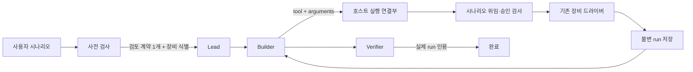

# 실행부 교체 4단계 — 호스트 소유 하드웨어 실행 연결

날짜: 2026-09-10

## 결과

하드웨어 시나리오도 `Lead → Builder → Verifier` 대화 흐름으로 실행할 수 있게 연결했다.
에이전트는 개발용 Plan, `prepared_plan`, 계약 파일명, 계약 해시, run 이름을 만들지 않는다.
Builder가 공개된 장비 도구와 실제 동작 인자만 요청하면 호스트가 나머지 실행 경계를 구성한다.

사전 검사에서 검토 완료된 계약을 하나로 고르지 못하거나 요청 장비를 식별하지 못하면 기존
호환 경로를 유지한다. 이 경우 새 실행부가 계약이나 장비를 추측하지 않는다.

## 단순해진 경계

- Builder 응답은 `status=device`와 `{tool, arguments}` 한 개만 사용한다.
- 공개 장비 스키마에서 `contract`와 `record_name`을 제거했다.
- 선택된 계약 이름과 SHA-256은 Brief의 호스트 입력으로 고정한다.
- 계약 경계와 연결 위임 원문은 에이전트 문맥에서 숨기고 호스트 실행부만 읽는다.
- 호출 직전에 제출 시나리오의 `scenario_access`와 현재 연결 맵을 다시 검사한다.
- 기존 승인 원장과 `HardwareApprovalGate`에서 실행 권한 한 건을 기록하고 소비한다.
- 기존 MCP registry handler가 실제 드라이버와 run 저장을 담당한다.
- 장비 결과는 같은 Builder 대화로 돌아가며 Verifier는 이 job에서 반환된 run을 인용해야 한다.
- 최종 결과 화면은 인용된 run 디렉터리를 열 수 있는 아티팩트로 등록한다.

계약은 제거하지 않았다. 계약은 모델 간 개발 문서가 아니라 호스트가 소유한 장비 안전 설정으로만
남는다. 전압·전류·종단·핀·허용 동작과 장비 연결 확인은 기존 검사에서 계속 강제한다.

## 실패와 재실행

드라이버가 정상적인 FAIL 결과와 run을 반환하면 Builder가 결과를 읽고 수정하거나 종료 판단을 한다.
호출을 보낸 뒤 연결이 끊겨 결과를 확정할 수 없으면 `conversation.device.failed`를 기록하고 job을
중단한다. 플랫폼은 같은 동작을 자동 재실행하지 않는다.

## 구현 위치

- `orchestrator/conversation_hardware.py`: 계약 비노출 도구 목록과 호스트 실행 연결부
- `orchestrator/conversation_flow.py`: 장비 요청·결과 반환·run 근거 검증
- `orchestrator/control.py`: 식별된 신규 하드웨어 시나리오 라우팅
- `orchestrator/scenario_access.py`: Conversation Brief의 제출 범위 검증
- `orchestrator/results.py`: Verifier가 인용한 run 아티팩트 등록
- `webui/frontend/src/app/conversation.ts`: 장비 시작·완료·불명 결과 표시

## 검증 범위

실물 장비에 접촉하지 않는 모의 드라이버로 다음을 확인했다.

- Plan 없이 장비 요청 후 같은 Builder로 결과가 돌아오는 흐름
- 모델이 계약과 run 이름을 공급하지 못하는 경계
- 호스트의 계약 해시 고정과 승인 1회 소비
- 이 job에서 반환되지 않은 run으로 Verifier가 완료할 수 없는 조건
- 결과 불명 호출을 자동 반복하지 않는 조건
- 제어면에서 검토 계약과 장비가 식별된 요청만 새 경로로 보내는 조건
- 최종 결과의 run 아티팩트 등록과 웹 피드 표시

Python 관련 회귀 159개 중 **158 passed** 후, 5초 시작 제한에 걸린 동시성 테스트 1개는 단독
재실행에서 통과했다. 프런트엔드 대화 피드 **28 passed**, 변경 Python 모듈 구문 검사도 통과했다.
실제 Codex 세 역할 전체 실행, 실물 장비 접속, 운영 데몬 재시작과 배포는 수행하지 않았다.
